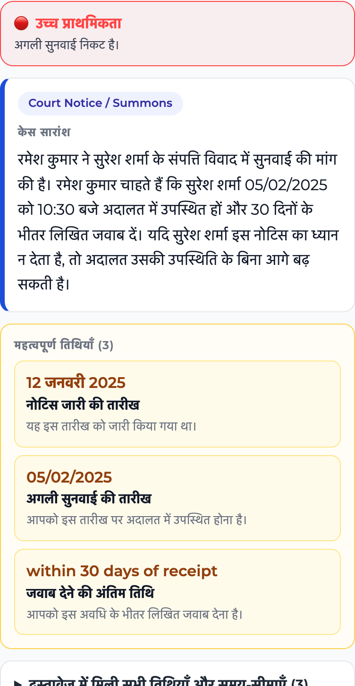
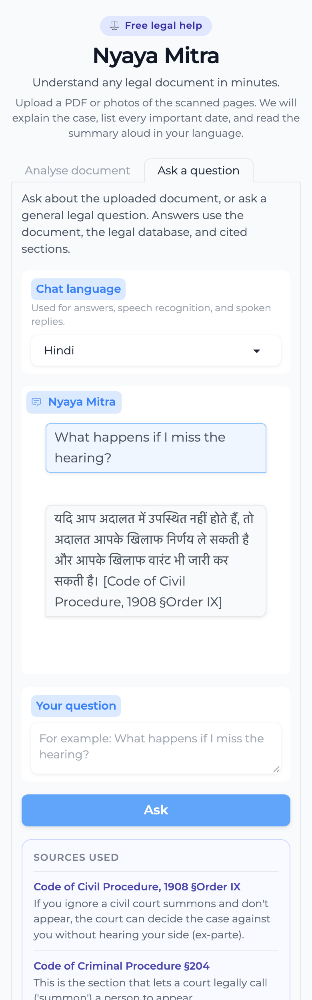

<p align="center">
  
</p>

<h1 align="center">⚖️ Nyaya Mitra v2</h1>

<p align="center">
  <strong>Understand any Indian legal document in minutes.</strong><br/>
  Upload a court summons, FIR, rent agreement, property document, or legal notice
  as a PDF or phone photos. Get a plain-language case summary, every important
  date, cited legal sources, and a spoken answer in Hindi, Marathi, Tamil, or Telugu.
</p>

<p align="center">
  
  
  
  
  
  
  
</p>

<p align="center">
  <sub>216 legal entries · 23 passing tests · 100% retrieval Hit@3 · mobile-first · cited answers</sub>
</p>

## 📸 Demo

<p align="center">
  
</p>

**Current status:** 216 legal-corpus entries (including a BNS/BNSS/BSA starter set), multilingual hybrid RAG, cited Q&A, voice input/output, 23 passing tests, and an evaluation harness with published metrics.

---

## ✨ What is new in this version

| Feature | Details |
|---|---|
| 📷 Photo / scanned-page upload | Upload JPG, PNG, WEBP, TIFF, or BMP photos of pages. The app automatically uses Tesseract if installed, then macOS Vision for English, then EasyOCR for Hindi/Marathi/Telugu. Multiple files can be uploaded in page order. |
| 📄 Mixed PDF support | PDFs with some typed pages and some scanned pages are handled page by page: text-layer pages are read normally, scan-like pages are OCR'd. PyMuPDF renders pages without needing Poppler. |
| 📅 Complete date list | The LLM is instructed to extract every hearing date, notice date, filing date, payment date, and relative deadline. A deterministic date scanner also lists every date-like string found in the raw text. |
| 🔎 Cited legal sources | RAG results now return the source and section (for example `Indian Penal Code §302`). The analysis page and the Q&A tab show the exact legal sources used. |
| 🧠 Hybrid multilingual RAG | Multilingual E5 embeddings + BM25 keyword search + a multilingual cross-encoder reranker, fused with reciprocal-rank fusion. Hindi, Tamil, and Telugu queries now retrieve the right sections. |
| ⚖️ BNS / BNSS / BSA starter mapping | The legal corpus now includes 21 starter entries for the new Indian criminal codes, with old-to-new section notes. Clearly marked as needing legal review. |
| 📊 Evaluation + CI | `eval/run_eval.py` measures date recall/precision, retrieval hit@1/hit@3/MRR, document classification, and schema validity. Pytest tests and a GitHub Actions workflow are included. |
| 💬 Ask a question | A new chat tab answers follow-up questions using the uploaded document + cited legal database. Works with a document, or as a general legal question assistant. |
| 🎙️ Voice input and spoken answers | Record or upload a question; Whisper transcribes it, the cited RAG answers it, and gTTS reads the answer aloud. A “Play last answer” button also works for typed questions. |
| 🗂️ Case summary first | The summary is the first thing shown after the urgency banner, followed by a dedicated important-dates card. |
| 📱 Mobile-friendly UI | Single-column layout, large tap targets, 16px inputs (no iOS zoom), stacked date cards, and a max-width that fits small screens. |
| 🌐 Localized analysis | The LLM writes the summary, dates, urgency, rights, and audio script in the selected language. If a small model slips into English, a field-by-field local translation pass fixes it — no external translation API or rate limit. |
| 🎧 Audio | gTTS reads the localized summary aloud. Regional-script text is preserved correctly. |
| 🔐 Privacy and sharing | Uploaded documents are deleted immediately after extraction, logs avoid document text, and the result page includes a WhatsApp share link. Result labels are localized into all four supported languages. |

---

## 🏗️ How it works

```
Upload PDFs / page photos
          │
          ▼
pdf_extractor.py
  PyPDF2 text layer per page
  + OCR fallback: Tesseract → macOS Vision → EasyOCR
          │
          ▼
classifier.py  →  document type (summons, FIR, rent, property, notice)
          │
          ▼
rag.py  →  multilingual hybrid retrieval (ChromaDB + BM25 + reranker)
           with BNS/BNSS/BSA + IPC/CrPC/Consumer Protection sources
          │
          ▼
analyser.py  →  local Llama via Ollama, or Groq on Spaces
  Pydantic-validated JSON (in the selected language): summary,
  all critical dates, parties, conditions, urgency, rights, next steps
          │
          ▼
app.py  →  localized HTML + gTTS audio + WhatsApp share
          │
          ▼
chat.py  →  follow-up questions with cited RAG sources
```

---

## 📁 Project structure

```
Nyaya-Mitra-v2/
├── app.py                  # Gradio UI, mobile CSS, pipeline orchestration
├── pdf_extractor.py        # PDF text extraction + image OCR + multi-file input
├── date_extractor.py       # Deterministic date/deadline scanner
├── classifier.py           # Keyword-based document type detection
├── analyser.py             # LLM provider + Pydantic validation + retries
├── rag.py                  # Multilingual E5 + BM25 hybrid retrieval + reranker
├── chat.py                 # Cited RAG Q&A over the document
├── voice.py                # Whisper speech-to-text + gTTS spoken answers
├── build_chroma_index.py   # One-time legal corpus index builder
├── legal_corpus.json       # BNS/BNSS/BSA + IPC/CrPC + Consumer Protection entries
├── chroma_db/              # Persisted vector index
├── audio_generator.py      # Translation helpers + gTTS audio script
├── eval/                   # Evaluation dataset + metrics harness
├── tests/                  # Pytest unit tests
├── ci/github-actions.yml   # CI workflow (copy to .github/workflows/ to enable)
├── requirements.txt
├── requirements-dev.txt
├── requirements-ocr-fallback.txt
├── packages.txt            # Hugging Face Spaces system packages
└── README.md
```

---

## 🔧 Tech stack

| Component | Tool |
|---|---|
| UI | Gradio 4.44 |
| PDF text | PyPDF2 |
| OCR | Tesseract → macOS Vision → EasyOCR fallback chain |
| PDF rendering | PyMuPDF (no Poppler required) |
| Document classification | Regex keyword scoring |
| Legal analysis | Ollama locally (Llama 3.1/3.2), Groq on Hugging Face Spaces |
| Legal context | ChromaDB + multilingual-e5-small + BM25 + multilingual cross-encoder reranker |
| Localization | Local LLM field-by-field translation (no external API) |
| Evaluation | Custom harness (`eval/run_eval.py`) + pytest + GitHub Actions |
| Text-to-speech | gTTS |
| Speech-to-text | faster-whisper (Whisper model, runs locally) |
| Audio preprocessing | static-ffmpeg (bundled ffmpeg/ffprobe) |
| Validation | Pydantic 2 |

Total cost to run: **₹0** (local model + free services).

---

## 🚀 Setup

### 1. Install system OCR dependencies (optional but recommended)

Tesseract gives the best multilingual results, especially for Tamil. If it
is not installed, the app falls back to macOS Vision (English) and then
EasyOCR if you install the optional fallback.

macOS:
```bash
brew install tesseract tesseract-lang poppler
```

Ubuntu / Debian:
```bash
sudo apt update
sudo apt install tesseract-ocr tesseract-ocr-hin poppler-utils
```

### 2. Create a virtual environment and install Python packages

```bash
cd Nyaya-Mitra-v2
python3 -m venv .venv
source .venv/bin/activate       # Windows: .venv\Scripts\activate
pip install -r requirements.txt

# Optional: multilingual OCR fallback when Tesseract is not installed
pip install -r requirements-ocr-fallback.txt

# Optional: tests, lint, evaluation
pip install -r requirements-dev.txt
```

> The first OCR request may take a few minutes while EasyOCR downloads its
> models. They are cached in `~/.EasyOCR` and reused afterwards.
>
> The first RAG request downloads `multilingual-e5-small` (~120 MB) and the
> multilingual cross-encoder reranker (~470 MB). They are cached afterwards.
>
> The first voice request also downloads the Whisper model
> (`small` by default, about 500 MB). Use `WHISPER_MODEL=tiny` or `base` for
> a faster first run.

### 3. Install and start Ollama

```bash
# Install Ollama from https://ollama.com, then:
ollama serve
ollama pull llama3.1:8b

# Lighter test model:
ollama pull llama3.2:3b
```

The app uses `llama3.1:8b` by default. Override with environment variables:

```bash
export OLLAMA_HOST=http://localhost:11434
export OLLAMA_MODEL=llama3.2:3b
```

Or run against Groq instead of Ollama:

```bash
export LLM_PROVIDER=groq
export GROQ_API_KEY=your_key
export GROQ_MODEL=llama-3.1-8b-instant
```

### 4. Build the legal vector index

```bash
python build_chroma_index.py
```

The app also builds the index automatically on first startup if `chroma_db/`
is missing.

### 5. Run

```bash
python app.py
```

Open **http://localhost:7860**.

---

## ☁️ Deploy to Hugging Face Spaces

Hugging Face now requires a paid plan to create Gradio Spaces on **CPU
basic**, but free personal accounts can host up to **2 Gradio Spaces on
ZeroGPU**. This project is configured for that free ZeroGPU tier: the LLM
runs on Groq, while OCR and TTS run on CPU. The Linux requirements pin
`torch==2.8.0`, which is a ZeroGPU-supported version.

1. Create a Space at [huggingface.co/new-space](https://huggingface.co/new-space):
   - SDK: **Gradio**
   - Hardware: **ZeroGPU (free tier)**
   - Template: **Blank**
2. Push this project to the Space repository, keeping:
   - `README.md` (with its YAML front matter)
   - `app.py`
   - `requirements.txt`
   - `packages.txt`
   - all Python modules, `legal_corpus.json`, and `build_chroma_index.py`
3. In **Settings → Variables and secrets**, add:
   - `LLM_PROVIDER=groq`
   - `GROQ_API_KEY=your_key_from_console.groq.com`
   - `GROQ_MODEL=llama-3.1-8b-instant`
   - optional `WHISPER_MODEL=tiny` for a faster demo, or `small` for quality
4. `packages.txt` installs Tesseract (English, Hindi, Marathi, Tamil, Telugu),
   Poppler, and FFmpeg automatically.
5. The first startup builds the Chroma legal index automatically. This can
   take a minute or two; watch the Space logs.

Notes:

- ZeroGPU is free with quotas for personal accounts. The app does not use
  the GPU directly; it is simply the available free Gradio hardware.
- `ocrmac` is macOS-only, so on the Space the OCR path uses Tesseract (and
  EasyOCR only if you install the optional fallback).
- Free hardware is slower than a local machine; the first voice request also
  downloads the Whisper model.
- For the full local-Ollama version, deploy a Docker container on a VM,
  Render, Railway, or Fly.io instead.

---

## 📱 Opening it on a phone

- **Same Wi-Fi:** run the app, then open `http://<your-computer-LAN-IP>:7860` on the phone. The server listens on `0.0.0.0` so LAN access works.
- **Anywhere:** enable the temporary public Gradio link with `GRADIO_SHARE=1 python app.py`.
- **Custom port:** `PORT=8080 python app.py`.

On a phone, tap the upload box and choose **Camera** to photograph each page, or select existing photos from the gallery. Upload pages in order.

---

## 💬 Ask a question

After analysing a document, open the **Ask a question** tab. Example questions:

- “What happens if I miss the hearing?”
- “What should I do next?”
- “Can I get free legal aid?”
- “Explain the most important date.”

You can also use the tab without uploading a document for general legal questions. Answers use the legal database and show the cited source sections underneath.

### Voice

In the same tab:

1. Choose the **Chat language**.
2. Tap the microphone and record your question, or upload a voice note.
3. Tap **Transcribe and ask**.
4. The question is transcribed, answered with cited RAG, and the answer is spoken aloud.
5. For typed questions, use **Play last answer** to hear the latest response.

On a phone, browser microphone access requires a secure context — use the HTTPS Gradio share link. The same-Wi-Fi `http://<LAN-IP>:7860` address may block the microphone, so upload a voice note there instead.

---

## 📊 Evaluation

Run the built-in evaluation harness:

```bash
python eval/run_eval.py
```

It measures:

- date extraction recall and precision
- document classification accuracy
- retrieval Hit@1, Hit@3, and MRR
- schema validation accuracy
- per-stage latency

Current results on the included synthetic dataset:

| Metric | Result |
|---|---|
| Date recall | **100%** |
| Date precision | **100%** |
| Document classification | **100%** |
| Retrieval Hit@1 | **78.3%** |
| Retrieval Hit@3 | **100%** |
| Retrieval MRR | **0.891** |
| Schema validation | **100%** |

The multilingual hybrid-RAG upgrade moved retrieval on the same 18-query core set from:

| Version | Hit@1 | Hit@3 | MRR | Indic queries hit |
|---|---|---|---|---|
| English-only dense retrieval | 61.1% | 77.8% | 0.694 | 0 / 4 |
| Multilingual E5 + BM25 + reranker | **77.8%** | **100%** | **0.889** | **4 / 4** |

The full 23-query benchmark (which adds five BNS/BNSS/BSA questions) scores **78.3% Hit@1, 100% Hit@3, and 0.891 MRR**.

**Caveat:** the dataset is currently 10 synthetic documents, 23 retrieval questions, and 3 schema cases. It is a starter benchmark, not a substitute for real anonymised documents reviewed by a lawyer.

### Tests and CI

```bash
pytest -q
ruff check .
```

The GitHub Actions workflow is stored in `ci/github-actions.yml`. Enable it by copying it to `.github/workflows/ci.yml` and pushing with a token that has `workflow` scope, or add it through the GitHub web UI. It runs lint, tests, and the evaluation harness on every push.

---

## 📋 Supported inputs and document types

**Inputs:** PDF, PNG, JPG/JPEG, WEBP, TIFF, BMP — one file or many pages at once.

**Document types detected:** Court notice/summons, FIR, rent/lease agreement, property document, legal notice, and generic legal documents.

**Audio languages:** Hindi, Marathi, Tamil, Telugu.

---

## ⚙️ Configuration

| Variable | Default | Purpose |
|---|---|---|
| `LLM_PROVIDER` | `ollama` locally, `groq` on Spaces | `ollama` or `groq` |
| `OLLAMA_HOST` | `http://localhost:11434` | Ollama server URL |
| `OLLAMA_MODEL` | `llama3.1:8b` | Ollama model name (`llama3.2:3b` for a lighter test model) |
| `GROQ_API_KEY` | unset | Groq API key when `LLM_PROVIDER=groq` |
| `GROQ_MODEL` | `llama-3.1-8b-instant` | Groq model name |
| `EMBEDDING_MODEL` | `intfloat/multilingual-e5-small` | Dense retrieval embedding model |
| `RERANK_MODEL` | `cross-encoder/mmarco-mMiniLMv2-L12-H384-v1` | Multilingual cross-encoder reranker |
| `OCR_LANGUAGES` | `eng+hin` | Default OCR language string used outside the UI |
| `TESSERACT_CMD` | auto-detected | Path to the tesseract binary |
| `WHISPER_MODEL` | `small` | Whisper model size (`tiny`, `base`, `small`, `medium`, `large-v3`) |
| `WHISPER_DEVICE` | `cpu` | faster-whisper device |
| `WHISPER_COMPUTE_TYPE` | `int8` | faster-whisper compute type |
| `PORT` | `7860` | Gradio port |
| `GRADIO_SHARE` | `0` | Set to `1` to enable the public Gradio share link |

---

## ⚠️ Known limitations

- OCR quality depends on photo clarity; well-lit, straight, full-page photos work best.
- The first OCR request can be slow if the optional EasyOCR fallback downloads models.
- The analysis prompt currently uses the first ~12,000 characters of the extracted text.
- Chat answers use the same configured LLM and the current legal corpus; a larger corpus will improve them.
- The BNS/BNSS/BSA entries are a starter mapping (21 entries) and need review by a lawyer; the corpus is not yet comprehensive.
- The evaluation dataset is small and synthetic; expand it with anonymised real documents and lawyer-reviewed labels.
- Tamil OCR still needs Tesseract for reliable results.
- Voice input needs a microphone; on phones this requires the HTTPS Gradio share link, or upload a voice note.
- Whisper accuracy drops with background noise, strong accents, or very quiet recordings.
- The first voice request downloads the Whisper model (`small` is about 500 MB).
- Local LLM inference (3B/8B) can be slow on CPU, especially the first request.
- gTTS requires an internet connection.
- Very small local models may need the field-by-field localization fallback; 8B-quality models produce more polished regional-language text.
- Tamil/Telugu TTS quality is good but not perfect for complex legal terms.
- This is general legal information, **not legal advice**.

---

## 🔐 Privacy and data handling

- Uploaded PDFs/images are deleted immediately after text extraction.
- Logs record file basenames, character counts, and timings — not document text.
- Generated audio files are written to the system temp directory and are not automatically deleted.
- There is currently no user authentication or persistent storage; do not run a public instance with sensitive real documents without adding access control and a retention policy.

---

## 📄 License

MIT — free to use, modify, and deploy.
